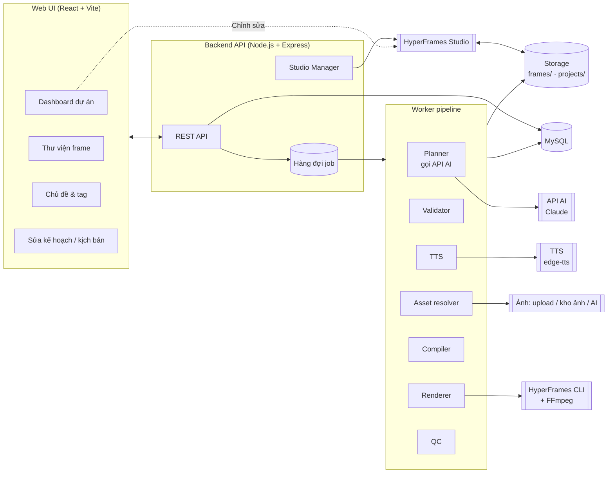
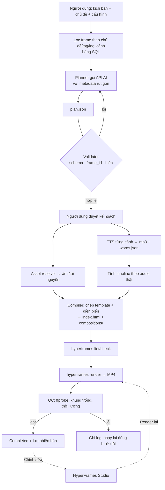
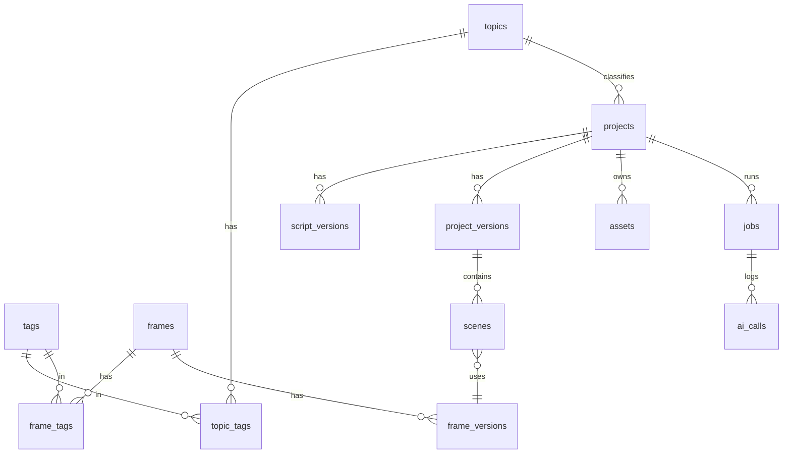
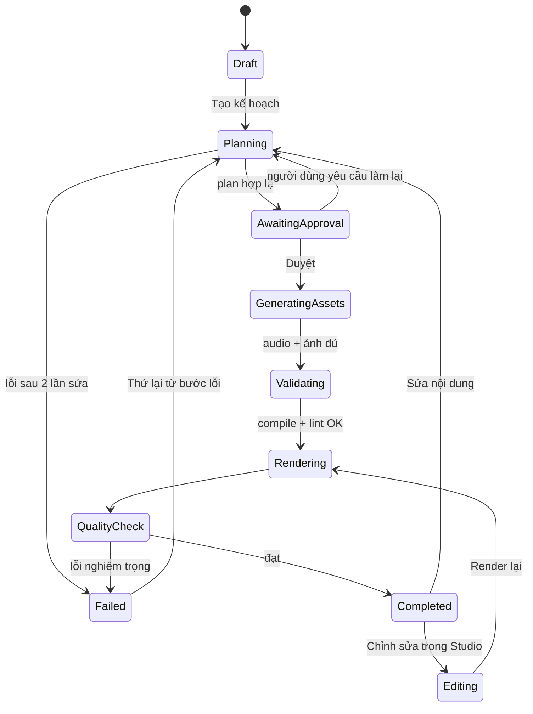

# Tài liệu thiết kế: Hệ thống thư viện frame và sản xuất video tự động bằng AI

> Phiên bản 1.0 · 22/10/2026
> Tổng hợp từ `mô tả hệ thống.txt` và các yêu cầu đã thống nhất trong quá trình trao đổi.

---

## Mục lục

1. [Bối cảnh và vấn đề](#1-bối-cảnh-và-vấn-đề)
2. [Tổng hợp yêu cầu](#2-tổng-hợp-yêu-cầu)
3. [Nguyên tắc thiết kế](#3-nguyên-tắc-thiết-kế)
4. [Kiến trúc tổng thể](#4-kiến-trúc-tổng-thể)
5. [Các phân hệ](#5-các-phân-hệ)
6. [Cấu trúc thư mục](#6-cấu-trúc-thư-mục)
7. [Mô hình dữ liệu](#7-mô-hình-dữ-liệu)
8. [Hợp đồng template (frame)](#8-hợp-đồng-template-frame)
9. [Kế hoạch video `plan.json`](#9-kế-hoạch-video-planjson)
10. [Quy trình xử lý (pipeline)](#10-quy-trình-xử-lý-pipeline)
11. [Chỉnh sửa video bằng HyperFrames Studio](#11-chỉnh-sửa-video-bằng-hyperframes-studio)
12. [Phiên bản và xử lý lại một phần](#12-phiên-bản-và-xử-lý-lại-một-phần)
13. [Kiểm tra chất lượng](#13-kiểm-tra-chất-lượng)
14. [Chi phí và tối ưu token](#14-chi-phí-và-tối-ưu-token)
15. [Bảo mật và vận hành](#15-bảo-mật-và-vận-hành)
16. [Lộ trình triển khai](#16-lộ-trình-triển-khai)
17. [Tiêu chí nghiệm thu](#17-tiêu-chí-nghiệm-thu)
18. [Các vấn đề cần quyết định](#18-các-vấn-đề-cần-quyết-định)

---

## 1. Bối cảnh và vấn đề

### 1.1. Cách làm trước đây

| Cách làm | Mô tả | Vấn đề |
|---|---|---|
| `server/` hiện tại (MMO Video Studio) | Mỗi câu thoại là một cảnh; gọi Claude API (`max_tokens` 16.000) để **vẽ nét SVG cho từng cảnh** | Số token tăng theo số cảnh, AI sinh hình mới mỗi lần nên kết quả khó kiểm soát và khó tái tạo |

Cách này để **AI tạo ra hình ảnh trong mỗi video**. Đây là phần tốn token nhất và cũng khó kiểm soát chất lượng nhất.

### 1.2. Hướng giải quyết

Chuyển sang mô hình **thư viện template**:

- Template (frame) được **viết, kiểm thử một lần** rồi dùng lại cho mọi video.
- Với mỗi video, AI **chỉ viết kịch bản và lập kế hoạch**: chia cảnh, chọn `frame_id`, điền nội dung vào biến. Đầu ra là một file JSON nhỏ.
- **Code đảm nhận mọi việc còn lại**: kiểm tra, tạo giọng đọc, khớp timeline, ghép template, render, kiểm tra chất lượng.

Ước tính sơ bộ (chưa đo thực tế): mỗi video còn khoảng **10–20 nghìn token**, rẻ hơn hàng chục đến hàng trăm lần so với cách cũ.

---

## 2. Tổng hợp yêu cầu

### 2.1. Yêu cầu chức năng

| Mã | Yêu cầu | Nguồn |
|---|---|---|
| R1 | Quản lý thư viện frame/template: tạo, sửa, sao chép, xem trước, phân loại, tìm kiếm, quản lý phiên bản | Mô tả 3.1 |
| R2 | Quản lý chủ đề và tag; một frame có nhiều tag; lọc frame theo chủ đề trước khi gọi AI | Mô tả 3.2 |
| R3 | Quản lý dự án và kịch bản, có lịch sử chỉnh sửa và nhiều phiên bản | Mô tả 3.3 |
| R4 | AI viết/điều chỉnh kịch bản, chia cảnh, chọn frame **chỉ từ danh sách được cung cấp**, xuất JSON theo schema | Mô tả 3.4 |
| R5 | Người dùng xem, sửa, phê duyệt kế hoạch trước khi tạo tài nguyên | Mô tả 3.4 |
| R6 | Bộ biên dịch: chuyển `plan.json` thành dự án HyperFrames (HTML/CSS/JS) | Mô tả 3.5 |
| R7 | Quản lý tài nguyên: ảnh, video, nhạc, SFX, font, logo; kiểm tra tài nguyên thiếu trước khi render | Mô tả 3.6 |
| R8 | TTS theo từng cảnh; timeline tính theo **thời lượng audio thực tế**; tạo lại audio cho một cảnh | Mô tả 3.7 |
| R9 | Quản lý timeline: thứ tự, thời lượng, chồng lấn, khoảng trống | Mô tả 3.8 |
| R10 | Render bằng HyperFrames + FFmpeg trong worker có hàng đợi | Mô tả 3.9 |
| R11 | Kiểm tra chất lượng tự động trước và sau render | Mô tả 3.10 |
| R12 | Dashboard quản lý dự án, trạng thái, tiến trình, log, chi phí | Mô tả 3.11 |
| R13 | **Nút "Chỉnh sửa" mở thẳng HyperFrames Studio** cho đúng video đó để chỉnh tay trên timeline | Trao đổi |
| R14 | **Mỗi video là một thư mục dự án riêng**, không clone repository HyperFrames; HyperFrames CLI chỉ cài một lần | Trao đổi |
| R15 | **Thư viện frame được xây dựng một lần ở giai đoạn đầu**, mở rộng dần khi cần | Trao đổi |
| R16 | Khi hoàn thành, chi phí mỗi video chủ yếu chỉ còn: API AI (viết kịch bản, lập kế hoạch) + TTS (+ ảnh nếu dùng AI tạo ảnh) | Trao đổi |

### 2.2. Yêu cầu phi chức năng

- **Tiết kiệm token**: không gửi toàn bộ thư viện, không gửi mã nguồn template cho AI, không dùng phiên agent cho từng video.
- **Tái tạo được**: cùng đầu vào và cùng phiên bản template thì render ra cùng kết quả.
- **Truy vết được**: lưu đầu vào, đầu ra và log của từng bước, kể cả lượng token đã dùng.
- **Dễ thay nhà cung cấp**: tách lớp AI, TTS và ảnh để đổi nhà cung cấp mà không viết lại hệ thống.
- **An toàn**: API key chỉ nằm ở backend; không thực thi mã do AI sinh ra.

### 2.3. Phạm vi giai đoạn đầu

Video **tin công nghệ, tiếng Việt, 16:9, dài 1–3 phút**, một người dùng, chạy trên máy cá nhân.

---

## 3. Nguyên tắc thiết kế

1. **AI quyết định nội dung, code quyết định mọi thứ khác.** AI hiểu kịch bản và chọn frame. Code truy vấn thư viện, kiểm tra, quản lý file và chạy pipeline.
2. **AI không viết template trong lúc tạo video.** AI chỉ trả về `frame_id` và giá trị biến. Backend từ chối mọi `frame_id` hoặc biến không hợp lệ.
3. **Lọc trước khi gọi AI.** Danh sách frame gửi cho AI được lọc bằng code/DB và chỉ gồm metadata rút gọn.
4. **JSON là định dạng trung tâm.** Không dùng XML.
5. **Audio quyết định thời gian.** Thời lượng cảnh lấy từ file audio thật cùng thời điểm của từng từ, không lấy theo ước đoán của AI.
6. **Template phải tái sử dụng và có phiên bản.** Sửa template không được làm thay đổi video cũ, nên khi biên dịch template sẽ được **chép** vào thư mục video.
7. **Chỉ làm lại phần thay đổi.** Mỗi bước lưu kết quả kèm mã băm đầu vào; đầu vào không đổi thì bỏ qua bước đó.
8. **Bắt đầu nhỏ.** Chạy được một video hoàn chỉnh rồi mới mở rộng (xem [mục 16](#16-lộ-trình-triển-khai)).

---

## 4. Kiến trúc tổng thể

### 4.1. Sơ đồ thành phần



### 4.2. Phân tầng

| Tầng | Công nghệ | Trách nhiệm |
|---|---|---|
| Giao diện | React 18 + Vite + React Router (dùng lại `web/`) | Dashboard, thư viện frame, chủ đề/tag, sửa kế hoạch, nút mở Studio |
| API | Node.js + Express 5 (dùng lại `server/`) | CRUD, khởi chạy job, theo dõi trạng thái, quản lý tiến trình Studio |
| Hàng đợi | Giai đoạn 1: hàng đợi trong tiến trình (như `jobs.js` hiện tại). Giai đoạn 2: bảng `jobs` trong MySQL + worker riêng | Chạy pipeline bất đồng bộ, giới hạn số job render đồng thời |
| Pipeline | Các module Node.js độc lập | Planner, Validator, TTS, Asset, Compiler, Renderer, QC |
| Dữ liệu | MySQL 8 | Metadata: dự án, frame, chủ đề, tag, job, chi phí |
| File | Thư mục `storage/` | Template, tài nguyên, dự án HyperFrames, MP4 |
| Bên ngoài | Claude API, edge-tts, nguồn ảnh, HyperFrames CLI, FFmpeg | Các dịch vụ được bọc sau một giao diện (interface) chung |

### 4.3. Luồng dữ liệu chính



---

## 5. Các phân hệ

### 5.1. Thư viện frame

- Mỗi frame là **một thư mục** gồm `template.html` và `meta.json` (xem [mục 8](#8-hợp-đồng-template-frame)), kèm một bản ghi trong bảng `frames` để truy vấn.
- Trạng thái: `draft` → `active` → `deprecated`. AI chỉ được thấy frame ở trạng thái `active`.
- Mỗi lần sửa template tạo một **phiên bản mới** (`frame_versions`). Dự án lưu phiên bản mà nó đã dùng.
- Mỗi frame có ảnh hoặc video xem trước, được tạo bằng cách render template với `sample_input` trong `meta.json`.
- **Nguồn template**:
  1. Ưu tiên tận dụng **registry của HyperFrames** (khoảng 400 block/component: biểu đồ, terminal, hiệu ứng chữ, chuyển cảnh…), bọc thêm `meta.json`.
  2. Chỉ viết mới khi registry không có. Phần này làm bằng Claude Code **một lần**.
- **Thư viện hiện có (23 frame, 16:9)**, chia theo chủ đề qua tag:

| Nhóm | Frame |
|---|---|
| Mở đầu (mỗi chủ đề một kiểu) | `intro-news` (Công nghệ), `intro-show` (Giải trí), `intro-lesson` (Học tập) |
| Kết thúc (dùng chung) | `outro-subscribe` |
| Dùng chung | `headline`, `bullet-list`, `stat-big`, `quote`, `compare-2col`, `image-caption`, `big-question`, `timeline-steps`, `summary-recap` |
| Số liệu | `bar-chart` (theo tag `statistics`, kiểu biến `numbers`) |
| Giải trí | `top-rank` (bảng xếp hạng đếm ngược), `fun-fact` (Bạn có biết?), `profile-card` (giới thiệu nhân vật), `quiz` (dùng chung với Học tập) |
| Học tập | `definition` (thuật ngữ), `quiz` (trắc nghiệm, đáp án hiện theo từ khoá), `process-flow` (sơ đồ A → B → C), `fun-fact` |
| Công nghệ | `spec-sheet` (thông số), `code-snippet` (khung code gõ từng dòng), `pros-cons` (ưu/nhược), `process-flow` |
| Lớp chung (không phải frame) | nền theo chủ đề, phụ đề karaoke, chuyển cảnh `fade` / `wipe` |

- Ảnh xem trước của từng frame theo từng chủ đề: `npm --prefix server run preview:frames` → `storage/frame-previews/<chủ đề>/<frame_id>.png`. Script dựng frame bằng dữ liệu `sample` trong `meta.json`, không gọi AI hay TTS.
- Quy ước thêm frame mới: xem `server/frames/README.md`.

### 5.2. Chủ đề và tag

- `topics` chứa `default_tags`, `related_tags` và `default_categories`.
- Quan hệ nhiều-nhiều `frame_tags`.
- **Thuật toán lọc** (chạy bằng SQL, không dùng AI):
  1. Lấy tag mặc định của chủ đề.
  2. Lọc frame `active`, đúng tỷ lệ khung hình, có ít nhất một tag khớp.
  3. Loại frame thiếu tài nguyên bắt buộc.
  4. Xếp hạng theo số tag khớp, ưu tiên `default_categories`.
  5. Giới hạn N frame cho mỗi loại cảnh (mặc định N = 5).
  6. Nếu không đủ: mở rộng sang `related_tags`, rồi đến frame dùng chung (intro/outro/subtitle/transition).
  7. Vẫn không đủ: báo cho người dùng biết thiếu loại frame nào.
- **Đã triển khai (dạng file, chưa dùng bảng MySQL):** mỗi chủ đề là một file `server/topics/<topic_id>.json` gồm `name`, `description`, `tone` (giọng văn đưa vào prompt), `kicker`, `default_tags`, `related_tags`, `background` (`grid` / `burst` / `paper`) và `theme` (bảng màu CSS dùng cho mọi frame và phụ đề). Hiện có 3 chủ đề: **Giải trí** (tím – vàng – hồng, nền tia sáng), **Học tập** (nền giấy kẻ dòng sáng màu, xanh dương – xanh lá), **Công nghệ** (xanh đậm, nền lưới). Dự án lưu chủ đề ở cột `projects.topic`.
- **Thuật toán lọc thực tế** (`selectFrames` trong `catalog.js`): mỗi tag của frame được cộng điểm (tag mặc định của chủ đề 3 điểm, tag liên quan và `common` mỗi tag 1 điểm). Frame 0 điểm bị loại. Mỗi `scene_type` giữ tối đa 4 frame có điểm cao nhất. Nếu chủ đề không có frame intro/outro riêng thì lấy intro/outro bất kỳ. Mỗi chủ đề hiện gửi cho AI 16–17 frame.
- Thêm một chủ đề mới chỉ cần thêm một file JSON (và các frame gắn tag của chủ đề đó, nếu muốn có frame riêng).

### 5.3. Dự án và kịch bản

- Thông tin dự án: tên, kịch bản, chủ đề, mục đích, ngôn ngữ, độ dài mong muốn, tỷ lệ khung hình, độ phân giải, phong cách, giọng đọc, tốc độ đọc, yêu cầu đặc biệt.
- Lưu lịch sử kịch bản (`script_versions`); từ một kịch bản có thể tạo nhiều phiên bản video.

### 5.4. Planner (AI)

Có thể gọi AI theo hai cách, cấu hình được:

| Cách | Lần gọi | Khi dùng |
|---|---|---|
| Gộp | 1 lần: kịch bản thô → `plan.json` | Nhanh, rẻ |
| Tách | Lần 1: viết hoặc chuẩn hoá lời thoại → người dùng sửa. Lần 2: lập kế hoạch cảnh và chọn frame | Kiểm soát nội dung tốt hơn (**khuyến nghị**) |

- **Đầu vào gửi cho AI**: kịch bản, cấu hình video, danh sách frame rút gọn (`frame_id`, tên, mô tả, `scene_type`, tag, biến và giới hạn của biến, thời lượng gợi ý). **Không gửi mã HTML.**
- **Đầu ra**: JSON theo schema (dùng structured output hoặc tool use để ép đúng định dạng).
- **Ràng buộc trong prompt**: chỉ dùng `frame_id` có trong danh sách; không dùng một frame cho mọi cảnh; tuân thủ giới hạn ký tự của biến.
- Nếu Validator báo lỗi, gửi lại cho AI **chỉ phần lỗi** để sửa, tối đa 2 lần.
- Dùng model rẻ hơn (Sonnet/Haiku) cho bước lập kế hoạch khi đạt chất lượng; có thể cấu hình model riêng cho từng bước.
- Ghi vào `ai_calls`: model, token vào/ra, số frame đã gửi, thời gian, kết quả.

### 5.5. Validator

Kiểm tra `plan.json`:

1. Đúng JSON schema.
2. Mọi `frame_id` tồn tại, `active` và có trong danh sách đã gửi cho AI.
3. Biến đúng kiểu, đủ biến bắt buộc, không vượt giới hạn độ dài.
4. Tài nguyên được tham chiếu tồn tại hoặc có cách lấy.
5. Thứ tự cảnh liên tục; chuyển cảnh hợp lệ.

### 5.6. TTS và đồng bộ

- Dùng lại `edge-tts` hiện có. TTS **bắt buộc trả về thời điểm của từng từ** (`WordBoundary`), lưu thành `sNN.words.json`.
- Nếu đổi sang dịch vụ TTS không có thời điểm từng từ: thêm bước dò thời điểm (forced alignment, ví dụ `hyperframes transcribe`).
- Thời lượng cảnh = thời lượng audio thật (đo bằng `ffprobe`) + khoảng đệm đầu và cuối. Không dùng thời lượng do AI ước tính.
- Nếu audio vượt `max_duration` của frame: tăng tốc độ đọc trong giới hạn (tối đa khoảng +10%), hoặc nhờ AI rút gọn câu, hoặc báo người dùng.
- Mỗi file audio lưu kèm mã băm của `(text, voice, rate)`; mã băm không đổi thì không tạo lại.

### 5.7. Asset resolver (hình ảnh và tài nguyên)

- Nguồn ảnh theo thứ tự ưu tiên (cấu hình được): người dùng tải lên → kho ảnh có giấy phép → tạo ảnh bằng AI.
- Prompt ảnh **không phải** là ảnh: chỉ khi file ảnh đã tồn tại trong `assets/` thì cảnh mới được coi là đủ tài nguyên.
- Kiểm tra định dạng, kích thước, đường dẫn trước khi biên dịch.

### 5.8. Compiler

1. Tạo thư mục `projects/<slug>/`.
2. **Chép** template của các frame được dùng (đúng phiên bản) vào `compositions/`.
3. Điền biến vào template, gồm cả thời lượng cảnh và thời điểm của các từ khoá.
4. Sinh `index.html` (host composition) với các cảnh xếp nối tiếp trên timeline, cùng track audio và track phụ đề.
5. Chép font và tài nguyên vào `assets/`.
6. Chạy `hyperframes lint` / `hyperframes check`. Có lỗi thì dừng, không render.

Cách này kế thừa `composer.js` hiện tại, nhưng thay phần "vẽ" bằng phần "điền template".

### 5.9. Renderer

- Chạy `npx hyperframes render` trong thư mục dự án, xuất `renders/vN.mp4`.
- Chạy trong worker; giới hạn số render đồng thời (mặc định 1); có timeout và tối đa 1 lần thử lại.
- Đọc log và tiến trình, ghi vào bảng `jobs`.

### 5.10. Studio Manager

Xem [mục 11](#11-chỉnh-sửa-video-bằng-hyperframes-studio).

### 5.11. Dashboard

- Danh sách dự án kèm trạng thái và tiến trình.
- Trang chi tiết dự án:
  - kịch bản
  - kế hoạch cảnh, sửa được từng cảnh: lời thoại, frame, biến
  - audio từng cảnh
  - timeline
  - các phiên bản video
- Nút **Duyệt kế hoạch**, **Tạo lại audio cảnh**, **Chỉnh sửa trong Studio**, **Render lại**.
- Thư viện frame: lưới ảnh xem trước, lọc theo loại cảnh/tag, chi tiết biến.
- Chủ đề và tag: hiển thị số frame khớp sau khi lọc.
- Log lỗi, lịch sử job, thống kê token và chi phí.

---

## 6. Cấu trúc thư mục

Không clone repository HyperFrames cho mỗi video. HyperFrames CLI chạy qua `npx hyperframes@<phiên bản cố định>` (phiên bản đặt trong `HYPERFRAMES_VERSION`), tải một lần vào cache của npm. Mỗi video chỉ là một thư mục vài MB.

Thư viện frame nằm trong `server/frames/` (không phải `storage/`) vì `storage/` bị gitignore, còn template là mã nguồn cần lưu trong git.

```
E:\MMO\
├─ docs\                        ← tài liệu (file này)
├─ web\                         ← React UI
├─ server\
│   ├─ frames\                  ← THƯ VIỆN TEMPLATE (dùng chung, lưu trong git)
│   │   ├─ README.md            ← quy ước viết frame
│   │   ├─ headline\  meta.json · template.html
│   │   └─ stat-big\ ...
│   ├─ scripts\
│   │   ├─ make-video.js        ← lệnh chạy cả pipeline (giai đoạn 1)
│   │   └─ tts_words.py         ← edge-tts + thời điểm từng từ
│   ├─ samples\                 ← kịch bản mẫu để chạy thử
│   ├─ src\
│   │   ├─ video\               ← PIPELINE MỚI
│   │   │   ├─ catalog.js       ← đọc thư viện frame, lọc frame cho AI
│   │   │   ├─ planner.js       ← gọi AI (hoặc mock), sinh plan.json, tự sửa lỗi
│   │   │   ├─ validate.js      ← kiểm tra frame_id, biến, giới hạn ký tự
│   │   │   ├─ tts.js           ← giọng đọc, bỏ qua cảnh không đổi (mã băm)
│   │   │   ├─ timeline.js      ← thời lượng theo audio thật, mốc từ khoá, phụ đề
│   │   │   ├─ template.js      ← điền biến vào template
│   │   │   ├─ compile.js       ← plan + template → dự án HyperFrames
│   │   │   ├─ render.js        ← lint, render, kiểm tra chất lượng
│   │   │   ├─ pipeline.js      ← các bước trên gộp lại, dùng chung cho dòng lệnh và API
│   │   │   ├─ jobs.js          ← hàng đợi (làn AI và làn render), ghi bảng jobs
│   │   │   ├─ studio.js        ← bật/tắt HyperFrames Studio cho từng dự án
│   │   │   └─ proc.js          ← chạy tiến trình con (python, ffprobe, npx)
│   │   └─ routes\
│   │       └─ projects.js      ← API dự án, kế hoạch, dựng, render, Studio, ảnh + /api/frames
│   └─ sql\schema.sql
└─ storage\
    ├─ shared-assets\           ← font, nhạc nền, SFX, logo
    └─ projects\                ← MỖI VIDEO MỘT THƯ MỤC
        └─ tin-iphone-18\
            ├─ script.txt       ← tư liệu đầu vào
            ├─ project.json     ← cấu hình dự án
            ├─ plan.json        ← kế hoạch (nguồn gốc dữ liệu)
            ├─ ai_calls.json    ← token đã dùng cho từng lần gọi AI
            ├─ timeline.json    ← thời điểm từng cảnh, phiên bản frame đã dùng
            ├─ index.html       ← do Compiler sinh ra
            ├─ compositions\    ← s01.html… (template đã chép + điền biến), background, captions, transitions
            ├─ assets\
            │   ├─ vo\ s01.mp3 · s01.words.json · s01.meta.json ...
            │   ├─ img\
            │   └─ fonts\
            ├─ hyperframes.json
            ├─ .manual-edit     ← có file này nghĩa là đã sửa tay trong Studio (giai đoạn 2)
            ├─ qc.json          ← kết quả kiểm tra bản render mới nhất
            └─ renders\ v1.mp4 · v2.mp4
```

---

## 7. Mô hình dữ liệu



| Bảng | Cột chính |
|---|---|
| `frames` | `id`, `frame_id` (slug, duy nhất), `name`, `description`, `category`, `scene_type`, `aspect_ratios` JSON, `status`, `current_version` |
| `frame_versions` | `id`, `frame_id`, `version`, `path`, `inputs_schema` JSON, `min_dur`, `max_dur`, `rec_dur`, `dependencies` JSON, `preview_path`, `created_at` |
| `tags` | `id`, `slug`, `name` |
| `frame_tags` | `frame_id`, `tag_id` |
| `topics` | `id`, `topic_id`, `name`, `description`, `default_categories` JSON, `status` |
| `topic_tags` | `topic_id`, `tag_id`, `kind` (`default` / `related`) |
| `projects` | `id`, `slug`, `title`, `topic_id`, `language`, `aspect_ratio`, `width`, `height`, `fps`, `voice`, `voice_rate`, `style`, `target_duration`, `status`, `manual_edit`, `current_version` |
| `script_versions` | `id`, `project_id`, `version`, `text`, `source` (`user`/`ai`), `created_at` |
| `project_versions` | `id`, `project_id`, `version`, `plan` JSON, `plan_hash`, `output_path`, `duration`, `qc_report` JSON, `created_at` |
| `scenes` | `id`, `project_version_id`, `idx`, `frame_version_id`, `inputs` JSON, `voice_text`, `audio_path`, `audio_hash`, `audio_duration`, `start`, `duration` |
| `assets` | `id`, `project_id`, `kind`, `path`, `format`, `source`, `license`, `status`, `hash` |
| `jobs` | `id`, `project_id`, `type` (`plan`/`tts`/`compile`/`render`/`qc`), `status`, `progress`, `attempt`, `log`, `error`, `started_at`, `finished_at` |
| `ai_calls` | `id`, `job_id`, `provider`, `model`, `input_tokens`, `output_tokens`, `frames_sent`, `latency_ms`, `cost_estimate`, `created_at` |

Các bảng của luồng vẽ tay cũ (`video_types`, `videos`, `scenes`) đã bỏ khỏi `schema.sql`; database cũ vẫn còn các bảng này cho tới khi xoá tay.

---

## 8. Hợp đồng template (frame)

### 8.1. `meta.json`

```json
{
  "frame_id": "stat-big",
  "version": 2,
  "name": "Số liệu lớn",
  "description": "Một con số nổi bật đếm lên, kèm nhãn và chú thích nguồn. Dùng khi lời thoại nhấn mạnh một con số.",
  "category": "data",
  "scene_type": "stat",
  "tags": ["technology", "news", "statistics"],
  "aspect_ratios": ["16:9", "9:16"],
  "duration": { "min": 3, "max": 12, "recommended": 6 },
  "inputs": {
    "value":   { "type": "number", "required": true },
    "unit":    { "type": "string", "maxLength": 8 },
    "label":   { "type": "string", "required": true, "maxLength": 60 },
    "source":  { "type": "string", "maxLength": 80 },
    "emphasis_word": { "type": "string", "description": "Từ trong lời thoại; con số bắt đầu đếm khi từ này được đọc" }
  },
  "dependencies": { "fonts": ["BeVietnamPro"], "assets": [] },
  "sample_input": { "value": 1200000, "unit": "", "label": "máy bán ra trong tuần đầu", "source": "Counterpoint" }
}
```

### 8.2. Quy ước cho `template.html`

- Là một **sub-composition HyperFrames** chuẩn: timeline GSAP dạng paused, seek được, kết quả xác định (theo `hyperframes-core`).
- Nhận biến qua cơ chế variables của HyperFrames. Không đọc file, không gọi mạng.
- **Co giãn theo thời lượng**: timeline chia ba pha:
  - **vào**: cố định, khoảng 0,6–1 giây
  - **giữ**: kéo dài bằng thời lượng còn lại
  - **ra**: cố định, khoảng 0,4–0,6 giây

  Compiler truyền `duration` cho template.
- **Nhấn theo lời thoại**: Compiler truyền thời điểm (tính theo giờ của cảnh) của các từ trong `emphasis_word` / `keywords`. Template dùng các mốc này để kích hoạt chuyển động.
- Bố cục phải nằm trong vùng an toàn; chữ dài thì tự co lại hoặc xuống dòng, không được tràn.
- Mỗi template phải qua `hyperframes lint` + `check` và render được với `sample_input` thì mới được chuyển sang trạng thái `active`.

---

## 9. Kế hoạch video `plan.json`

```json
{
  "schema_version": 1,
  "project": { "title": "iPhone 18 có gì mới", "aspect_ratio": "16:9", "language": "vi" },
  "voice": { "provider": "edge-tts", "voice": "vi-VN-HoaiMyNeural", "rate": "+6%" },
  "music": { "asset": "shared:bgm/tech-light-01.mp3", "volume": 0.12 },
  "scenes": [
    {
      "id": "s01",
      "frame_id": "headline",
      "voice_text": "Apple vừa chính thức ra mắt iPhone 18 với ba thay đổi lớn.",
      "inputs": { "title": "iPhone 18 ra mắt", "subtitle": "3 thay đổi đáng chú ý" },
      "keywords": ["iPhone 18", "ba thay đổi"],
      "transition_out": "tr-slide"
    },
    {
      "id": "s02",
      "frame_id": "stat-big",
      "voice_text": "Chỉ trong tuần đầu, hơn một triệu hai trăm nghìn máy đã được bán ra.",
      "inputs": { "value": 1200000, "label": "máy bán ra trong tuần đầu", "source": "Counterpoint", "emphasis_word": "triệu" },
      "keywords": ["một triệu hai trăm nghìn"],
      "assets_needed": [],
      "transition_out": "tr-fade"
    }
  ]
}
```

- AI **không** điền `start` hay `duration`. Hai giá trị này do Compiler tính từ audio.
- `assets_needed` mô tả tài nguyên cần lấy (ví dụ `{ "kind": "image", "query": "iPhone 18 mặt lưng" }`). Asset resolver xử lý mục này, sau đó cảnh mới được biên dịch.

---

## 10. Quy trình xử lý (pipeline)

### 10.1. Các trạng thái dự án



### 10.2. Các bước chi tiết

| # | Bước | Thực hiện | Đầu ra |
|---|---|---|---|
| 1 | Tạo dự án | UI → API | bản ghi `projects`, `script_versions` |
| 2 | Lọc frame | SQL | danh sách frame rút gọn |
| 3 | Lập kế hoạch | API AI | `plan.json` (bản nháp) |
| 4 | Kiểm tra | Validator | `plan.json` hợp lệ hoặc danh sách lỗi |
| 5 | Duyệt | Người dùng | kế hoạch được chốt |
| 6 | Giọng đọc | TTS | `vo/sNN.mp3` + `sNN.words.json` |
| 7 | Tài nguyên | Asset resolver | `assets/img/...` |
| 8 | Timeline | Compiler | `start`/`duration` của từng cảnh |
| 9 | Biên dịch | Compiler | `index.html`, `compositions/` |
| 10 | Lint | `hyperframes lint` + `check` | báo cáo |
| 11 | Render | `hyperframes render` | `renders/vN.mp4` |
| 12 | Kiểm tra chất lượng | QC | `qc_report` |
| 13 | Hoàn tất | API | `Completed`, lưu `project_versions` |

---

## 11. Chỉnh sửa video bằng HyperFrames Studio

### 11.1. Cách hoạt động

Đã triển khai ở giai đoạn 2 (`server/src/video/studio.js`):

1. Dự án phải được **dựng** trước (nút "Chỉ dựng" hoặc "Duyệt & render").
2. Người dùng bấm **Chỉnh sửa trong Studio**. API chạy lệnh sau, với cổng = 3100 + (id dự án mod 100):
   ```
   npx hyperframes@<phiên bản> preview "<thư mục dự án>" --background --no-open --port <cổng> --json
   ```
   Lệnh trả về JSON có `studioUrl` dạng `http://localhost:<cổng>/#project/<slug>`. Phải truyền thư mục dự án trực tiếp vào lệnh: nếu chỉ đặt thư mục làm việc (cwd), Studio có thể mở nhầm thư mục `server`.
3. UI mở URL này ở **tab mới**. Nhúng bằng iframe chưa được kiểm chứng.
4. Người dùng chỉnh trên timeline của Studio; Studio ghi thẳng vào file HTML của dự án.
5. **Phát hiện chỉnh sửa tay**: mỗi lần dựng, hệ thống lưu mã băm của HTML vào `.compile-hash`. Mã băm hiện tại khác mã đã lưu nghĩa là đã có sửa tay. Studio tự gắn thuộc tính `data-hf-id` vào mọi phần tử khi mở dự án lần đầu, nên thuộc tính này được bỏ qua khi tính mã băm, để mở Studio mà không sửa gì sẽ không bị tính là sửa tay.
6. **Đóng Studio** chạy `preview --stop` và ghi `projects.manual_edit`. Nút **Render** xuất đúng HTML đang có, gồm cả chỉnh sửa tay. Phiên bản tạo ra được đánh dấu `manual_edit` trong `project_versions`.
7. Trang dự án đang mở sẽ hỏi lại server 15 giây một lần để giữ Studio. Studio không được dùng quá 30 phút thì tự tắt.
8. Danh sách Studio đang mở chỉ lưu trong bộ nhớ. Sau khi server khởi động lại, trang sẽ hiện nút mở Studio như chưa mở; bấm lại sẽ dùng luôn Studio đang chạy ở cùng cổng.

### 11.2. Hai tầng chỉnh sửa (tránh mất dữ liệu)

HTML được sinh ra từ `plan.json`, còn Studio sửa trực tiếp vào HTML. Vì vậy:

| Loại sửa | Sửa ở đâu | Hệ quả |
|---|---|---|
| **Nội dung**: lời thoại, thứ tự cảnh, đổi frame, đổi biến, giọng đọc | Trang quản lý (sửa `plan.json`) | Tạo lại phần bị ảnh hưởng rồi biên dịch lại |
| **Tinh chỉnh hình**: vị trí, màu, nhịp, easing, cắt/xén | HyperFrames Studio (sửa HTML) | Dự án được đánh dấu `manual_edit` |

- Khi dự án có chỉnh sửa tay mà người dùng muốn dựng lại từ kế hoạch:
  1. API trả lỗi `409` kèm `code: "manual_edit"`; giao diện hỏi lại người dùng có muốn ghi đè không.
  2. Nếu đồng ý (`force: true`), hệ thống **sao lưu HTML hiện tại** vào `backups/<thời điểm>/` rồi mới ghi đè.
- Về sau có thể chỉ biên dịch lại đúng những cảnh bị đổi, giữ nguyên file HTML của các cảnh đã sửa tay (giai đoạn 3).

### 11.3. Giới hạn

- Studio chạy trên máy đang chạy backend. Rất phù hợp khi dùng một người trên máy cá nhân.
- Khi chạy trên server cho nhiều người: cần proxy theo từng phiên, xác thực và giới hạn số Studio chạy cùng lúc. Để giai đoạn sau.

---

## 12. Phiên bản và xử lý lại một phần

- Mỗi lần render thành công tạo một `project_versions` mới: lưu `plan` và `plan_hash`, phiên bản frame đã dùng, đường dẫn MP4 và báo cáo QC.
- Mỗi bước tính mã băm đầu vào. Nếu mã băm khớp với lần chạy trước thì bỏ qua bước đó:

| Thay đổi | Phải chạy lại |
|---|---|
| Lời thoại 1 cảnh | TTS cảnh đó → timeline → compile → render |
| Biến của 1 cảnh | compile → render |
| Đổi frame của 1 cảnh | compile → render |
| Đổi giọng đọc | TTS mọi cảnh → timeline → compile → render |
| Sửa tay trong Studio | render |

- HyperFrames render cả video trong một lượt. Render riêng từng cảnh rồi ghép bằng FFmpeg sẽ vướng ở các chuyển cảnh nối hai cảnh, nên chưa làm trong MVP.

---

## 13. Kiểm tra chất lượng

| Thời điểm | Kiểm tra | Mức độ khi lỗi |
|---|---|---|
| Trước render | JSON đúng schema; `frame_id` hợp lệ; biến hợp lệ | Chặn |
| Trước render | Tài nguyên tồn tại, đúng định dạng | Chặn |
| Trước render | `hyperframes lint` / `check` không có lỗi nghiêm trọng | Chặn |
| Trước render | Không có cảnh chồng lấn hay khoảng trống; audio không vượt timeline | Chặn |
| Sau render | MP4 đọc được; đúng độ phân giải, FPS, thời lượng (±0,2 giây) | Chặn |
| Sau render | Có track audio, mức âm thanh không bằng 0 | Chặn |
| Sau render | Không có khung đen/trống ngoài ý muốn (lấy mẫu khung hình) | Cảnh báo |
| Sau render | Phụ đề khớp lời thoại | Cảnh báo |

- Lỗi tự sửa được (thiếu audio, lỗi biên dịch) thì chạy lại đúng bước đó.
- Lỗi về nội dung thì chuyển cho người dùng quyết định.

---

## 14. Chi phí và tối ưu token

### 14.1. Chi phí cho mỗi video khi hệ thống hoàn thành

| Hạng mục | Nguồn | Ghi chú |
|---|---|---|
| Viết kịch bản + lập kế hoạch | API AI | Khoảng 10–20 nghìn token mỗi video (ước tính) |
| Giọng đọc | edge-tts | Miễn phí; dịch vụ TTS khác thì tính phí |
| Hình ảnh | Upload / kho ảnh / AI tạo ảnh | Nếu dùng AI tạo ảnh thì tính phí **theo từng ảnh**, không theo token |
| Ghép template, timeline, render, QC | Code + HyperFrames + FFmpeg trên máy | Không tốn phí API |

**Chi phí một lần**: xây dựng thư viện frame ban đầu. Mỗi frame mới về sau cũng chỉ tốn token một lần.

### 14.2. Quy tắc tiết kiệm token

1. **Không chạy phiên Claude Code/agent cho từng video.** Pipeline tự gọi API bằng code.
2. Không gửi mã HTML template cho AI, chỉ gửi metadata rút gọn.
3. Lọc frame bằng SQL trước, giới hạn N frame cho mỗi loại cảnh.
4. Khi AI trả kết quả lỗi, chỉ gửi lại phần lỗi, tối đa 2 lần.
5. Dùng model rẻ cho các bước đơn giản; cấu hình model riêng cho từng bước.
6. Dùng prompt caching cho phần cố định: hướng dẫn hệ thống, schema, danh sách frame.
7. Ghi `ai_calls` để đo token thực tế và đánh giá hiệu quả của việc lọc.

---

## 15. Bảo mật và vận hành

- API key nằm trong `server/.env`, không bao giờ gửi xuống frontend.
- Không thực thi mã do AI sinh ra. AI chỉ trả về dữ liệu JSON và được kiểm tra theo schema. Giá trị chuỗi được escape trước khi chèn vào HTML.
- Template không được đọc file hệ thống hay gọi mạng. Chỉ được dùng tài nguyên nằm trong thư mục dự án.
- Giới hạn dung lượng file và loại file khi upload.
- Giới hạn số render đồng thời; mỗi job có timeout và số lần thử lại.
- Log có cấu trúc theo `job_id` và từng bước.
- Dọn file tạm định kỳ; có thể tự xoá các bản render cũ, chỉ giữ N phiên bản gần nhất.
- Sao lưu MySQL và `storage/frames/`.
- Studio Manager chỉ lắng nghe trên `localhost`.

---

## 16. Lộ trình triển khai

### Giai đoạn 1: Pipeline tối thiểu (mục tiêu: ra được một MP4 tin công nghệ)

- [x] Quy ước `meta.json` (xem `server/frames/README.md`) và `plan.json`; schema cho AI được sinh từ `meta.json`.
- [x] 8 frame: `intro-news`, `headline`, `bullet-list`, `stat-big`, `compare-2col`, `quote`, `image-caption`, `outro-subscribe` + phụ đề karaoke + chuyển cảnh `fade`/`wipe`.
- [x] `planner.js`: một lần gọi API AI, gửi metadata rút gọn của các frame phù hợp (chưa lọc tag); tự yêu cầu AI sửa khi plan sai (tối đa 3 lần). Có chế độ `--mock` không tốn token.
- [x] `validate.js`, `tts.js`, `timeline.js`, `compile.js`, `render.js`.
- [x] Chạy bằng một lệnh → MP4 (xem bên dưới).
- [x] Đo token thực tế: **khoảng 3.300–4.600 token mỗi video** (1 lần gọi, effort `low`). Với effort `medium`, phần "suy nghĩ" của AI có thể đẩy lên hơn 11.000 token.

**Kết quả đo khi chạy thử** (kịch bản mẫu `server/samples/tin-cong-nghe.txt`, video khoảng 50 giây, 7–9 cảnh):

| Bước | Thời gian | Ghi chú |
|---|---|---|
| AI lập kế hoạch | 10–30 giây | 3.300–4.600 token |
| TTS (2 luồng song song) | 30–50 giây | edge-tts miễn phí; cảnh không đổi được dùng lại |
| Biên dịch + lint | dưới 5 giây | |
| Render 1080p | khoảng 3 phút | trên máy cá nhân |

**Cách chạy:**

```bash
cd server
node scripts/make-video.js samples/tin-cong-nghe.txt --slug tin-nova --seconds 60 --channel "Tên kênh"
```

Tuỳ chọn: `--title`, `--images <thư mục ảnh>` (để dùng frame `image-caption`), `--voice`, `--rate`, `--mock` (không gọi AI), `--replan` (bỏ plan cũ, gọi AI lại), `--no-render` (dừng sau lint). Chạy lại lệnh sẽ dùng lại `plan.json` và các file audio không đổi, nên có thể sửa tay `plan.json` rồi chạy lại.

Biến môi trường mới trong `server/.env`: `PLAN_MODEL` (model cho bước lập kế hoạch, mặc định `claude-sonnet-5-5`), `PLAN_EFFORT` (mặc định `low`).

### Giai đoạn 2: Web và quản lý

- [x] Bảng MySQL `projects`, `project_versions`, `ai_calls`, `jobs` (trong `server/sql/schema.sql`, tự tạo khi server khởi động). Các bảng chủ đề/tag và lịch sử kịch bản để sang giai đoạn 3. Kế hoạch lưu ở cột `projects.plan` (JSON), còn `plan.json` trên đĩa là bản đã dựng gần nhất.
- [x] Hàng đợi có hai làn: lập kế hoạch bằng AI không phải chờ render. Mỗi job ghi log vào bảng `jobs`. Job đang chạy dở khi server khởi động lại được đánh dấu lỗi.
- [x] Dashboard dự án (`/`): tạo dự án, danh sách kèm trạng thái, thời lượng, token.
- [x] Trang dự án: lập kế hoạch bằng AI hoặc mock; **sửa kế hoạch** (đổi frame, sửa lời đọc, từ khoá, chuyển cảnh, biến đầu vào có đếm ký tự; thêm, xoá, đổi thứ tự cảnh); lỗi hiện ngay dưới từng cảnh; **Duyệt & render**; **Chỉ dựng**; nghe audio từng cảnh (chỉ hiện khi audio khớp lời đọc hiện tại); cảnh báo khi kế hoạch đã đổi mà chưa dựng lại.
- [x] Tạo lại audio từng cảnh: tự động khi dựng. Chỉ những cảnh đổi lời, giọng hoặc tốc độ mới tạo lại audio, kể cả khi cảnh bị đổi thứ tự.
- [x] **Studio Manager + nút "Chỉnh sửa trong Studio"**, phát hiện chỉnh sửa tay, chặn ghi đè và sao lưu (mục 11).
- [x] Phiên bản video (v1, v2…), trình phát, tải MP4, kết quả QC; nhật ký 5 job gần nhất.
- [x] Thống kê token theo dự án (bảng `ai_calls`).
- [x] Trang thư viện frame (`/frames`): tab theo chủ đề, ảnh xem trước, metadata.
- [x] Ảnh của dự án: tải lên, xoá; dùng cho frame `image-caption` và `profile-card`.
- [x] Mở rộng thư viện lên 23 frame.
- [ ] Sửa metadata frame trên giao diện.

### Giai đoạn 3: Mở rộng

- [x] Chủ đề (Giải trí, Học tập, Công nghệ) với bộ màu, nền, giọng văn riêng; lọc frame theo tag và chấm điểm. Chọn chủ đề khi tạo dự án.
- [ ] Bảng `topics`/`tags` trong MySQL và trang quản lý chủ đề (hiện chủ đề là file JSON).
- [x] Giảm chi phí lập kế hoạch: đặt `PLAN_MODEL=claude-sonnet-5-5` (effort `low`). So sánh trên 2 video mẫu (đo qua cổng Caheo; giá theo bảng giá Anthropic, giá thực của cổng có thể khác):

  | Video | Model | Lần gọi | Token vào / ra | Chi phí ước tính |
  |---|---|---|---|---|
  | Giải trí | `claude-fable-5` | 1 | 3.170 / 7.675 | ≈ $0,42 |
  | Giải trí | `claude-sonnet-5-5` | 1 | 15.548 / 660 | ≈ $0,04 |
  | Học tập | `claude-fable-5` | 3 (2 lần sửa lỗi) | 12.032 / 6.204 | ≈ $0,43 |
  | Học tập | `claude-sonnet-5-5` | 1 | 16.000 + 4.062 cache / 716 | ≈ $0,04 |

  - Với Fable 5, chi phí chủ yếu nằm ở token ra, gồm cả phần suy nghĩ luôn bật. Sonnet 5.5 ra rất ít token, nên rẻ hơn khoảng 10 lần dù tính nhiều token vào hơn.
  - Token vào của Sonnet cao hơn mức `count_tokens` đếm được (khoảng 2.300 cho cả hai model), vì cổng API tự chèn thêm prompt riêng: một câu "ok" bị tính 2.283 token ghi cache trên Sonnet và 706 token vào trên Fable.
  - Chất lượng: cả hai đều chọn đúng frame theo chủ đề. Sonnet đa dạng frame hơn, không có cảnh nào vượt thời lượng tối đa, và không phải sửa lỗi. Nhưng video hơi dài hơn mục tiêu (67–74 giây cho mục tiêu 60 giây). Hai lần chạy Fable dùng phiên bản prompt cũ, trước khi thêm luật "mỗi frame tối đa 2 lần" và "lời đọc vừa thời lượng".
- [ ] Asset resolver: kho ảnh và tạo ảnh bằng AI.
- [ ] 9:16 và 1:1; nhiều ngôn ngữ; nhiều nhà cung cấp TTS.
- [ ] Biên dịch lại từng phần, giữ cảnh đã sửa tay.
- [ ] Sản xuất hàng loạt; chạy nhiều người dùng trên server.

---

## 17. Tiêu chí nghiệm thu

**Giai đoạn 1**

1. Từ một kịch bản, chạy một lệnh ra được MP4 16:9 có hình, chuyển cảnh, phụ đề và giọng đọc khớp nhau.
2. AI chỉ trả về JSON, mọi `frame_id` đều có trong thư viện; dữ liệu sai bị từ chối.
3. Timeline tính theo thời lượng audio thật.
4. Mỗi video tốn dưới khoảng 30 nghìn token (sẽ đo thực tế).

**Giai đoạn 2** (bổ sung tiêu chí 1–15 trong `mô tả hệ thống.txt`)

5. Quản lý được dự án, thư viện frame và các phiên bản trên giao diện web.
6. Bấm **Chỉnh sửa** mở đúng dự án trong HyperFrames Studio; sửa xong render lại ra phiên bản mới.
7. Sửa lời thoại một cảnh chỉ tạo lại audio của cảnh đó.
8. Lỗi được ghi log và xác định đúng bước gây lỗi.
9. Theo dõi được lượng token và chi phí cho từng video.

---

## 18. Các vấn đề cần quyết định

| # | Vấn đề | Lựa chọn | Đề xuất |
|---|---|---|---|
| 1 | Nguồn hình ảnh cho tin công nghệ | Upload thủ công / kho ảnh / AI tạo ảnh | Giai đoạn 1: upload + ảnh có sẵn; AI tạo ảnh để sau |
| 2 | Gọi AI một lần hay hai lần | Gộp / tách viết kịch bản và lập kế hoạch | Tách (dễ kiểm soát nội dung) |
| 3 | Model AI cho từng bước | Opus / Sonnet / Haiku | Thử Sonnet cho lập kế hoạch, đo chất lượng rồi quyết định |
| 4 | Nơi chạy hệ thống | Máy cá nhân / server | Máy cá nhân cho tới hết giai đoạn 2 |
| 5 | Mở Studio | Tab mới / iframe | Tab mới (đã chắc chắn chạy được) |
| 6 | Dữ liệu cũ (`video_types`, `videos`, `scenes`) | Giữ song song / chuyển đổi / bỏ | Đã bỏ luồng cũ |
